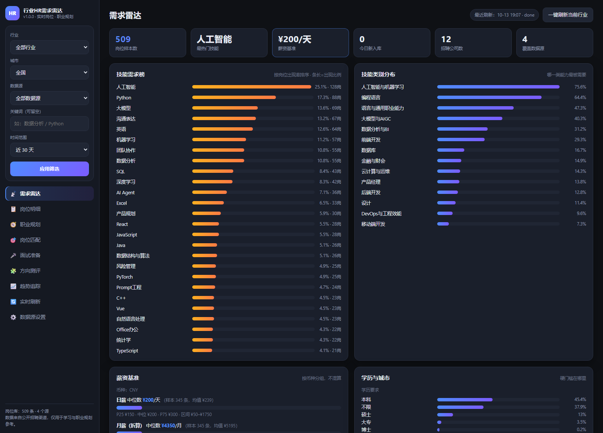
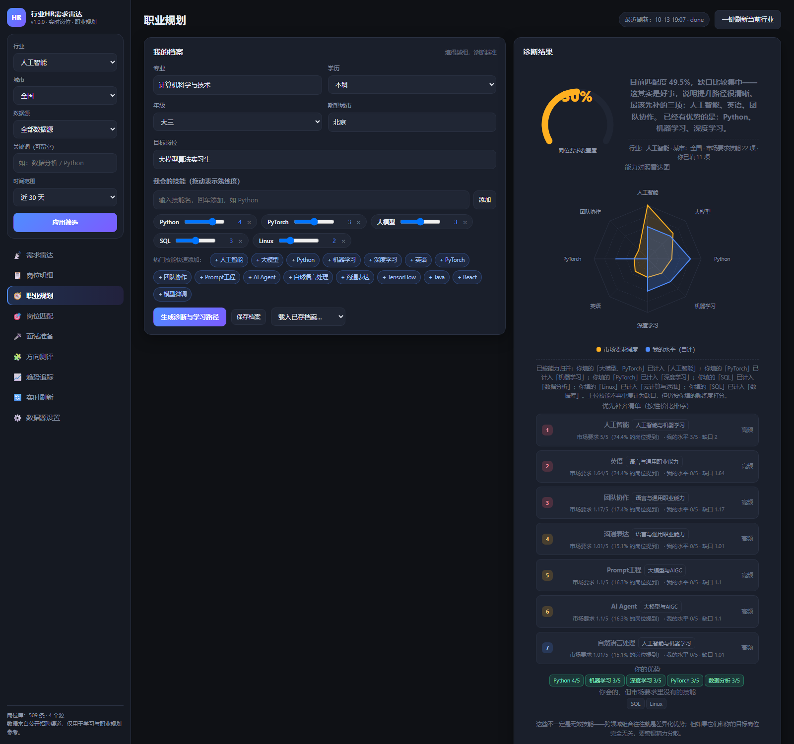
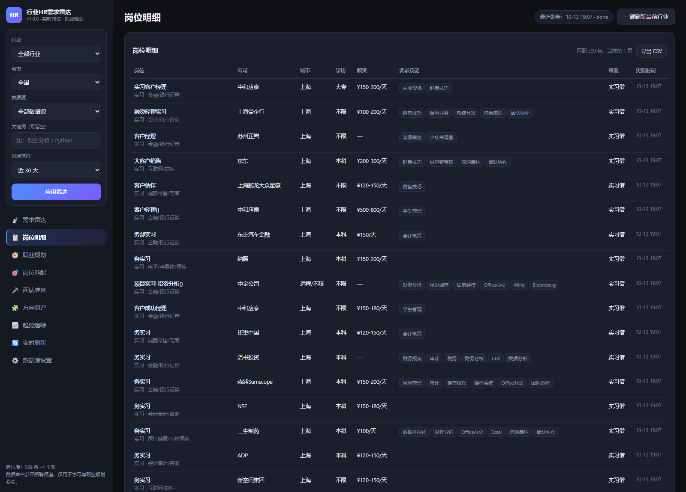

# 行业HR需求雷达 · 大学生职业规划工具

**实时抓取真实招聘岗位 → 量化出「这个行业到底要什么」→ 对上你自己的能力 → 告诉你缺什么、先补什么、怎么证明。**


一个**本地运行、零第三方依赖**的网页工具：实时抓取任意行业的真实招聘岗位，
量化出这个行业到底要什么技能、给多少钱、卡什么学历；再结合你自己的专业与能力，
给出匹配度、能力差距、可执行的学习路径，以及针对每一条真实岗位的投递建议。

面向对象是**在校大学生**（实习 / 校招 / 第一份工作）。

---

## 效果预览

以下都是工具真实运行时的截图（库内 509 条真实岗位，筛选条件：全部行业 / 全国 / 近 30 天）。

### 需求雷达 —— 这个行业到底要什么



把真实 JD 聚合成**技能需求榜**（按岗位出现率，长条长度＝该技能占比）、**技能类别分布**、
**薪资基准**（按币种分组，日薪/月薪 P25-中位-P75）、学历与城市分布，并自动生成数据洞察。

### 职业规划 —— 我还差什么



左边填专业/学历/年级/技能熟练度，右边直接给出**匹配度仪表盘**、
**能力对照雷达图**（市场要求强度 vs 我的水平）、按性价比排序的**优先补齐清单**、
**三阶段学习路径**、硬门槛自查与专业对口度。

> 截图用的是 `?demo=1` **一键示例模式**：自动填入一份示例档案并跑出结果，
> 方便你第一次打开就看清这个工具能给什么，不用先填一堆表单。

### 岗位明细 —— 数据从哪来



每一条都是可点开的真实岗位：JD 原文、自动抽取的技能、风险提示，支持筛选与 CSV 导出。

---

## 1. 快速开始

需要 **Python 3.10+**（无需 pip install 任何东西，只用标准库）。

```bash
cd hr-radar
python run.py
```

浏览器会自动打开 `http://127.0.0.1:8770/`。首次使用请到 **「实时刷新」** 页点一次「开始刷新」，
大概 30 秒就能拿到几百条真实岗位，然后各页面立刻有数据。

**还没数据也想先看看长什么样？** 用示例模式，会自动选定「人工智能」行业、填入一份示例档案
并跑完诊断与岗位匹配（只动前端，不写数据库）：

```
http://127.0.0.1:8770/?demo=1#career
```

**URL 支持页签深链**，方便收藏和分享具体某一页：

| 地址 | 页面 |
|---|---|
| `/#radar` | 需求雷达 |
| `/#jobs` | 岗位明细 |
| `/#career` | 职业规划 |
| `/#match` | 岗位匹配 |
| `/#interview` | 面试准备 |
| `/#survey` | 方向测评 |
| `/#trend` | 趋势追踪 |
| `/#refresh` | 实时刷新 |
| `/#settings` | 数据源设置 |

常用参数：

```bash
python run.py --port 9000        # 换端口
python run.py --no-browser       # 不自动开浏览器
python run.py --refresh          # 启动后立刻抓一次（默认行业：互联网）
python run.py --refresh --industry ai   # 启动后立刻抓人工智能行业
```

Windows 用户也可以直接双击 `start.bat`。

> **重复启动是安全的**：如果工具已经在运行，再次启动不会抢占端口，而是直接提示你打开
> 已有地址并自动打开浏览器。想重启就先关掉之前那个黑色窗口。

---

## 2. 为什么这样设计：先把痛点调研清楚

工具不是凭空设计的。下面是查到的真实数据，每一条都对应界面上的一个具体功能。

| 调研到的痛点 | 数据来源 | 本工具对应的功能 |
|---|---|---|
| **67.06%** 的受访者认为「求职目标不明确」是就业主要困难 | 中国青年报×粉笔，北京 10 所高校 1011 名受访者 | **方向测评**（6 维兴趣 → 行业倾向排序）、**分年级行动时间线** |
| **50.84%** 认为求职失败主因是「简历不过关」 | 同上 | **岗位匹配度**：用你的技能对上真实 JD 要求，命中/缺失技能逐条列出；**硬门槛自查**（学历/专业/经历） |
| **50.54%** 认为「不了解岗位」 | 同上 | **需求雷达**：把真实 JD 聚合成技能榜、薪资基准、学历与城市分布 |
| **49.95%** 面试太紧张、**49.46%** 表达沟通欠缺 | 同上 | **面试准备**：基于该行业真实高频技能生成问题 + 行为题 + 7 项自查清单；并给出「怎么答」的要点 |
| **57.1%** 的用人单位与 **27%** 的大学生认为「缺乏实践经验」是就业难首要因素；**59.6%** 的用人单位招人时首先看实习经历和实践能力 | 浙江省统计局专项统计，转引自清华大学教育研究院李锋亮教授 | **学习路径**：每个技能都给「怎么学」+ **「要拿出什么证明」+ 一个可做的小项目**，直接解决"没经历可写" |
| 超半数学生的实习与专业不挂钩或相关度不高，这类实习对就业能力提升有限 | 李锋亮（清华大学） | **专业对口度**：判断你的专业与该行业是否对口，不对口时给出「用项目+可迁移能力搭桥」的具体建议 |
| 大学生实习权益受侵害频发：求职诈骗、不签合同、薪酬与工时纠纷 | 李锋亮（清华大学） | **岗位风险提示**（押金/日结/付费内推等话术识别 + 薪资异常检测）、**实习权益自查清单** |
| 学生的思维与企业的思维、职场思维存在**信息差** | 西北农林科技大学生涯规划教师冯小龙，转引自中国青年报 | **数据洞察**：直接从真实岗位里读出「这个行业现在最看重什么」，而不是听经验之谈 |
| **63.8%** 认为「参加模拟面试」最能提升求职成功率 | 中国青年报×粉笔 | 面试清单里包含「录屏练 5 次自我介绍」「3 个 STAR 项目故事」等可执行动作 |

2025 届高校毕业生规模 **1222 万人**（同比 +43 万），这是所有分析的背景。

---

## 3. 功能一览

| 页面 | 做什么 |
|---|---|
| **需求雷达** | KPI 概览；技能需求榜（按岗位出现率）；技能类别分布；薪资基准（按币种分组，日薪/月薪/年薪 P25-中位-P75）；学历与城市分布；自动生成的数据洞察；用人最多的公司；数据构成与「新鲜度」（今日新入库多少条） |
| **岗位明细** | 全部真实岗位，可筛选/翻页/导出 CSV；点岗位名看 **JD 原文 + 自动抽取的技能 + 风险提示** |
| **职业规划** | 填写专业/学历/年级/目标岗位/技能自评 → 输出**匹配度仪表盘**、**能力对照雷达图**（市场要求 vs 我的水平）、**优先补齐清单**、**三阶段学习路径**、**硬门槛自查**、**专业对口度**、**分年级时间线**；档案可保存复用 |
| **岗位匹配** | 把库里所有真实岗位按你的画像打分排序，给出「命中哪些技能 / 还缺什么 / 学历是否够 / 是否值得优先投」 |
| **面试准备** | 基于该行业真实高频技能生成技术题 + 行为面试题 + 面试前自查清单 |
| **方向测评** | 6 个兴趣维度滑块 → 27 个行业的匹配度排序，附「为什么是这个行业」和常见对口专业 |
| **趋势追踪** | 每次刷新自动存快照，画出岗位量变化曲线与**技能需求升降榜**（哪些技能在变热/变冷） |
| **实时刷新** | 选行业（可多选）+ 自定义关键词 + 城市 + 数据源，实时进度与日志 |
| **数据源设置** | 开关各数据源；抓取参数（关键词数、JD 补全条数、请求间隔、并发）；**自定义接口**；用最新技能词典重算全库标签 |

---

## 4. 数据源：真实可用性说明（这部分请务必读）

工具本身不生产数据，它抓的是公开渠道。**各渠道的可抓性差异很大，这里如实说明**，
避免你误以为它能拿到"全网所有岗位"。

### 4.1 已内置且默认启用的源

| 数据源 | 市场 | 类型 | 状态 | 说明 |
|---|---|---|---|---|
| **实习僧** | 中国 | 实习/校招 | ✅ 已实测可用 | 国内大学生实习岗位主渠道。走站内前端同款公开检索接口，**支持关键词 + 城市过滤，单次每关键词最多返回 20 条**；详情页可补全完整 JD（技能抽取的主要来源） |
| **RemoteOK** | 国际 | 全职/远程 | ✅ 已实测可用 | 公开 JSON API，含年薪区间 |
| **Remotive** | 国际 | 全职/远程 | ✅ 已实测可用 | 公开 JSON API，支持 `search` 参数 |
| **Himalayas** | 国际 | 全职/远程 | ✅ 已实测可用 | 公开 JSON API，含薪资与结构化标签 |
| **Jobicy** | 国际 | 全职/远程 | ✅ 已实测可用 | 公开 JSON API |
| **The Muse** | 国际 | 全职 | ✅ 已实测可用 | 公开 JSON API，分页 |
| **Hacker News 招聘帖** | 国际 | 全职 | ✅ 已实测可用 | 通过 Algolia 检索最新一期「Who is hiring」的评论 |

### 4.2 已实测**不可用**的渠道（不要浪费时间）

以下渠道经实测存在反爬或需登录，**本工具不会去绕过它们**：

| 渠道 | 实测结果 |
|---|---|
| 拉勾 | 阿里云 WAF 拦截，返回验证页 |
| 智联招聘 | 搜索页返回 Security Verification 页；接口 405 |
| BOSS 直聘 | 接口返回风控 JSON |
| 猎聘 | 页面为前端渲染，PC 搜索接口返回 400 |
| 国家大学生就业服务平台（24365） | 岗位检索需登录 |
| 国家统计局数据库 | 接口 403 |

> **为什么不硬绕？** 绕过反爬既违反平台条款、也有法律风险，而且极其脆弱（对方改一次就失效）。
> 与其写一个随时会坏的东西，不如把架构做成**可插拔**，把"合法可得的源"标准化。

### 4.3 所以：如何覆盖"任意行业"

三层组合，保证任何行业都有数据：

1. **内置源 + 行业关键词矩阵**。每个行业预置了 10~14 个代表岗位关键词
   （如人工智能行业 → 算法工程师 / 机器学习工程师 / 大模型 / NLP / 计算机视觉…）。
   刷新时按这些关键词去打每一个源，实测一次刷新可稳定拿到 200~400 条真实岗位。
2. **自定义接口（企业/授权 API）**。这是覆盖中国市场最正规的路径：
   如果你有学校就业中心的内部接口、或购买了聚合数据 / 猎聘开放平台等商业配额，
   在「数据源设置 → 自定义接口」里填 `URL 模板` + `字段映射` 就能接入，
   之后完全走同一套分析和职业规划流程。支持 `{keyword}` `{city}` `{page}` 占位符。
3. **CSV 导出/对接**。`岗位明细` 页可一键导出 CSV，方便做课程作业或二次分析。

### 4.4 抓取礼节

- 同站请求间隔默认 `0.35s`，可在设置里调大；并发默认 6。
- 单次刷新对实习僧最多取 `关键词数 × 20` 条 + 最多补全 60 条 JD（均可配置）。
- **请不要把关键词数、并发调高后反复刷新**，那会给对方站点造成真实压力。
- 抓到的数据只存在你本地的 `data/radar.db`，不上传任何地方。

---

## 5. 数据质量：这个工具做了哪些"防误判"的工作

招聘文本很脏，随便做关键词匹配会得出荒谬结论。本工具在实测中修掉了这些坑，
它们是这个工具和"一次性的爬虫脚本"的主要区别：

1. **PDF/图标字体乱码**：部分平台把数字塞进 Unicode 私用区（PUA），提取时统一清除。
2. **详情页样板文本污染**：实习僧详情页 SSR 里含大量页脚（"校园招聘""关注公众号""版权所有"）。
   实测发现第一版抽取把页脚算进 JD，导致「校园招聘」以 30.9% 的占比霸占技能榜第一。
   现在通过**定位 `job_detail` 容器 + 27 个页脚截止词 + 样板文本截断**解决，JD 抽取已完全干净。
3. **薪资单位识别**：`day` / `annual` 这类规范 token 一度未被识别，导致日薪 200 元被当成月薪 200 元。
   现已修好，并正确处理 `8-12K`（乘数传导）、`$120,000 - $160,000`（千分位）、`1.5-2万/月·13薪`。
4. **跨行业技能误判**（这是最隐蔽的一类）：
   - `unity` 命中 comm**unity** / opport**unity** → 把 43 个无关岗位误判成游戏行业。
     现在纯 ASCII 关键词一律走**词边界匹配**（同时排除连字符与斜杠，避免 `$40/hr` 命中 `hr`）。
   - `word` 命中 "per-**word** basis"、`office` 命中 "our **office**"、`hr` 命中 "$40/**hr**"。
   - 引入了**歧义别名上下文守卫**：`agent`/`growth`/`office`/`word`/`招聘`/`薪酬`/`五险一金` 等
     必须同时出现真正的职能语境才算数。例如 JD 里的「招聘要求：」「现招聘实习生」
     是招聘方自述，不会被算成"招聘"这项技能；而「协助招聘专员完成简历筛选」会。
   - `方案设计`（建筑设计）不会命中产品 JD 里的"产品方案设计"；
     `量化`（量化投资）不会命中"量化评估变更效果"。
5. **行业分类的粒度冲突**：平台自带的行业标签很粗（实习僧把「大模型算法工程师」标成「互联网/游戏/软件」）。
   现在规则是**精确岗位词 > 平台粗标签**，但平台标签更精确时（如「汽车/新能源车」）仍然优先。
6. **匹配度虚高**：只识别出 1 项技能的岗位，匹配度会天然接近 100%。
   现在技能少于 2 项的岗位不参与匹配，且每条结果都会显示"JD 识别出 N 项技能"。

以上每一条都有对应的回归测试（见 `tests/`）。

---

## 6. 项目结构

```
hr-radar/
├── run.py                     # 启动入口（参数解析、自动开浏览器、定时刷新）
├── start.bat                  # Windows 双击启动
├── LICENSE                    # MIT
├── .gitignore                 # 排除 data/、__pycache__ 等
├── docs/screenshots/          # README 用的运行截图
├── radar/
│   ├── config.py              # 路径、默认设置、数据源元信息
│   ├── store.py               # SQLite：岗位库 / 刷新日志 / 行业快照 / 学生档案
│   ├── http.py                # 带 gzip、重试、按主机限速的极简 HTTP 客户端
│   ├── textutil.py            # 文本清洗、薪资解析（含单位折算）、城市/学历归一
│   ├── skills.py              # 技能知识库：400 技能 / 27 分类 / 1149 别名 + 抽取引擎 + 歧义守卫
│   ├── industries.py          # 27 个行业 + 分类器（ASCII 词边界匹配）
│   ├── pipeline.py            # 刷新流水线：并发抓取 → 分类 → 抽技能 → 入库 → 补 JD → 存快照
│   ├── analyzer.py            # 需求分析：技能榜/薪资统计/分布/新鲜度/趋势
│   ├── career.py              # 职业规划：诊断/差距/学习路径/匹配/面试/风险/测评/时间线
│   ├── reindex.py             # 词典升级后重算全库标签（不用重新抓取）
│   ├── server.py              # HTTP 服务 + JSON API + CSV 导出
│   └── sources/               # 可插拔数据源
│       ├── base.py            #   JobSource 基类 + FetchContext + build_job 归一
│       ├── __init__.py        #   注册表
│       ├── shixiseng.py       #   实习僧（含 JD 抽取）
│       ├── international.py   #   RemoteOK / Remotive / Himalayas / Jobicy / The Muse
│       ├── hn_hiring.py       #   Hacker News 招聘帖
│       └── custom_json.py     #   自定义/授权接口
├── web/                       # 前端，零外部依赖，图表全部手绘 SVG
│   ├── index.html
│   ├── styles.css
│   └── app.js
├── tests/
│   ├── smoke_test.py          # 端到端：真实抓取 → 分析 → 职业规划全链路
│   ├── test_skills.py         # 技能抽取回归（重点防跨域误判）
│   ├── test_classify.py       # 行业分类回归
│   ├── test_parsing.py        # 薪资解析 + JD 抽取（含真实页面）
│   └── diag_*.py              # 排查脚本（别名泛化度、误判上下文等）
└── data/                      # 运行时自动生成：radar.db / settings.json / exports
                               # （已 gitignore；克隆后首次启动自动重建，空库也能正常用）
```

> **已验证**：把仓库复制到一个**不含 `data/` 目录**的干净位置，`python run.py` 可直接启动；
> 空库状态下分析接口不报错，职业诊断会自动回落到「行业先验」模式（截图里的 `prior`），
> 刷新一次后切换为 `live` 真实数据。

---

## 7. 如何新增一个数据源

三步，不需要动其他任何代码：

1. 在 `radar/sources/` 下新建 `mysource.py`：

```python
from .base import FetchContext, JobSource, build_job

class MySource(JobSource):
    id = "mysource"
    name = "我的数据源"
    region = "cn"            # cn（中国市场）/ global
    kind = "实习"
    supports_keyword = True
    supports_city = False
    supports_detail = False  # 若 True，实现 fetch_detail_jd() 来补全 JD

    def fetch(self, ctx: FetchContext) -> list[dict]:
        from .. import http
        out = []
        for kw in ctx.keywords:
            data = http.get_json(f"https://api.example.com/jobs?kw={kw}",
                                 timeout=ctx.timeout, interval=ctx.interval)
            for it in data.get("list", []):
                out.append(build_job(
                    source=self.id, uid=it["id"], title=it["title"],
                    company=it["company"], city=it.get("city"),
                    salary_raw=it.get("salary"),      # 会自动解析成结构化薪资
                    jd=it.get("description"),         # 会自动用于技能抽取
                    url=it.get("url"), region="cn",
                ))
        return out
```

2. 在 `radar/sources/__init__.py` 的 `_INSTANCES` 里加一行 `MySource(),`。
3. 在 `radar/config.py` 的 `SOURCE_META` 里加一条元信息（名称、市场、说明、是否默认启用）。

`build_job()` 会统一完成薪资解析、城市归一、学历归一、标签清洗。

---

## 8. 主要 API（给二次开发用）

| 方法 | 路径 | 说明 |
|---|---|---|
| GET | `/api/meta` | 行业清单、数据源清单、设置、知识库规模、库内统计 |
| GET | `/api/skills` | 全部技能名与分类（用于技能输入联想） |
| GET | `/api/analysis` | 需求分析。参数：`industry` `city` `source` `keyword` `region` `days` `top_n` |
| GET | `/api/trend` | 趋势：`industry` `city` |
| GET | `/api/jobs` | 岗位列表（含分页），`/api/job` 取单条详情（含风险提示） |
| GET | `/api/interview` | 面试题：`industry` `city` `target_job` |
| GET | `/api/timeline` | 分年级行动时间线：`grade` |
| GET | `/api/risk-guide` | 实习权益自查清单 |
| GET | `/api/export` | 导出 CSV（同样支持全部筛选参数） |
| POST | `/api/refresh` | 启动刷新：`{industries, keywords, city, sources}` |
| GET | `/api/refresh/status` | 刷新进度（前端轮询） |
| POST | `/api/diagnose` | 职业诊断：`{profile, industry, city}` |
| POST | `/api/match` | 岗位匹配：`{profile, industry, city, limit}` |
| POST | `/api/survey` | 方向测评：`{scores: {data, people, build, create, order, research}}` |
| POST | `/api/profiles` | 保存学生档案；GET 列出，DELETE 删除 |
| POST | `/api/settings` | 保存设置 |
| POST | `/api/reindex` | 用最新技能词典重算全库标签、行业分类 |

`profile` 结构：

```json
{
  "major": "计算机科学与技术",
  "degree": "本科",
  "grade": "大三",
  "city_pref": "杭州",
  "target_job": "数据分析实习生",
  "skills": { "Python": 4, "SQL": 3, "Excel": 4 },
  "experiences": ["校园二手交易平台（个人项目）"]
}
```

`skills` 的值是 **1~5 的自评熟练度**（5 = 能独立做项目/带别人做）。

---

## 9. 测试

```bash
# 技能抽取回归（防跨域误判）
python tests/test_skills.py

# 行业分类回归（防 ASCII 关键词子串误命中）
python tests/test_classify.py

# 薪资解析 + 实习僧 JD 抽取（会真实联网抓几个详情页）
python tests/test_parsing.py

# 前端一致性：DOM id / 页签 / CSS 类 / 离线可用性
python tests/test_frontend.py

# 服务端健壮性：客户端强制断开不应产生堆栈噪音
python tests/test_server_noise.py

# 端到端：真实抓取 → 分析 → 职业规划全链路
python tests/smoke_test.py
```

`tests/diag_*.py` 是排查工具，用于定位"哪个别名泛化过头""哪个 JD 污染了统计"，
后续遇到误判可以复用这套方法。

> 提示：`test_parsing` 和 `smoke_test` 会真实联网。请保持礼貌频率，不要连续反复跑 `smoke_test`。

---

## 10. 已知限制（请如实理解）

- **实习僧单次每关键词只返回 20 条且无法翻页**。所以覆盖面靠"更多关键词 × 更多城市"来扩，
  而不是靠翻页。想拿更多数据，就多勾几个行业或自己填关键词、换城市多刷几次。
- **国际源的岗位是英文的**，技能抽取对英文的支持不如中文（但已通过词边界 + 歧义守卫做了处理）。
  分析页可以按数据源筛选，做中国市场分析时建议只看 `实习僧`。
- **学历要求只有实习僧提供**；国际源的学历一律显示"不限"，会拉高"不限"的占比。
- **趋势是"你抓到的样本"的趋势**，不是全网岗位总量的趋势。它反映的是技能需求结构的变化。
- **匹配度是启发式打分**，不是简历筛选模拟器。它的价值在于帮你发现"缺什么"和"哪些岗位投了大概率被刷"，
  而不是预测录取结果。
- **薪资统计按币种分组**，不会把美元年薪和人民币日薪混在一起算平均值。

---

## 11. 合规与免责

- 本工具只读取**公开招聘页面/公开接口**的信息，用于个人学习与职业规划参考。
- 不绕过任何登录、验证码或反爬机制；不采集个人信息；不提供数据转售。
- 请遵守目标站点的 robots.txt 与服务条款，并保持礼貌的抓取频率。
- 岗位信息以招聘方原始页面为准。**投递前请务必自行核实公司主体与岗位真实性**，
  任何要求先交钱、私下转账、宣称"零经验月入过万"的，都是高风险信号（工具已内置识别）。
